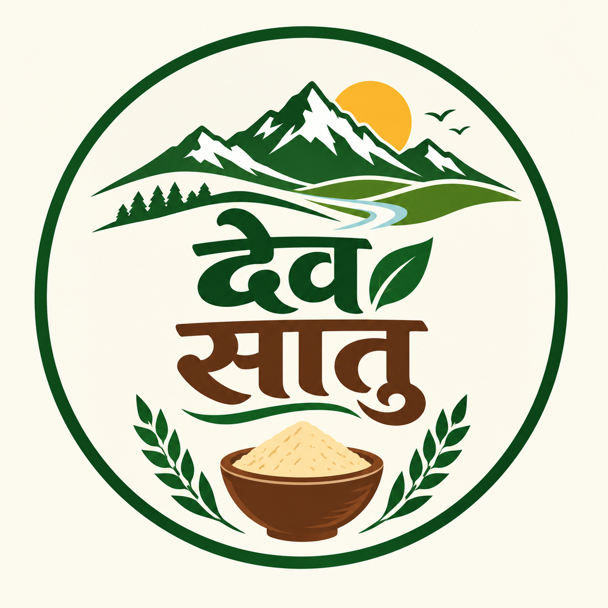
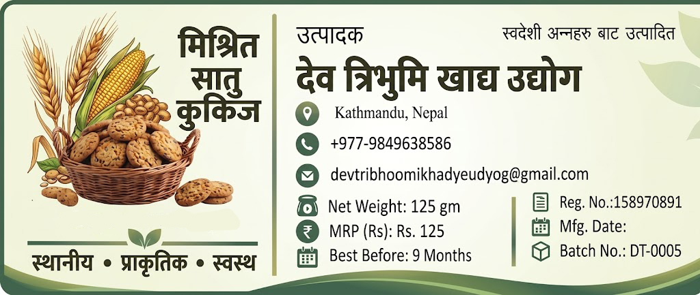

<!DOCTYPE html>
<html lang="ne">
<head>
<meta charset="UTF-8">
<meta name="viewport" content="width=device-width, initial-scale=1.0">
<title>Dev Foods & Organic</title>

</head>
<body>

<header>

Dev Foods

<nav class="menu">
<a href="#">Home</a>
<a href="#">Products</a>
<a href="#">About</a>
<a href="#">Contact</a>
</nav>
</header>

<section class="hero">
<h1>पुरानो स्वाद, शुद्ध परम्परा</h1>

सातु, कुकीज र अर्गानिक खाद्य सामग्री

<input class="search" type="text"
placeholder="उत्पादन खोज्नुहोस्...">
</section>

<section class="categories">

<h2>हाम्रा लोकप्रिय उत्पादनहरू</h2>

<h3>Dev Satu</h3>

घ्यू मिसाएर खाने परम्परागत सातु

<a href="#" class="btn">Order Now</a>

<h3>Cookies</h3>

पुरानो स्वादका स्वादिष्ट Cookies

<a href="#" class="btn">Order Now</a>

</section>

<footer>
<h3>Dev Foods & Organic</h3>

WhatsApp: 9849638583

devfood.com.np

</footer>

</body>
</html>
